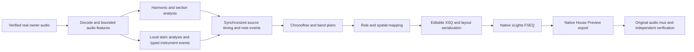

# PR188 native composition repair — 9 November 2026

Recovery base: `d00c2e4dbbfb60379da030a2780b14bff57f7303`.
Implementation: `c15bed4` (source routing), `1900958` (native opacity investigation),
`c80cbbd` (final scoped opacity policy and frozen-export preservation).
PR188 remains open; PR205 remains isolated. No merge, release, issue closure,
new owner approval, or final-nine ZIP was performed.

## Confirmed causes and corrections

| Cause | Responsible path | Evidence and correction |
|---|---|---|
| Role-wide broadcasting into single AC circuits | `tools/source_spatial_direction.py:schedule` | Real retained master gave 126 identical bass timelines and 87 identical keyboard timelines. `tools/source_role_routing.py` routes measured onsets and pitches through stable physical banks; build/chorus direction and breadth vary, explicit synchronized accents remain, and routed effects end at the source offset. |
| Note props assigned to bass | `tools/build_source_ac_review.py:geometry` | 32 numeric note props and 32 candy canes fell through the role-name classifier. They now receive keyboard cues. All original 256 addresses and fixed colors remain. |
| Dark native bulbs hide independent lit geometry | `tools/build_helpers/ultimate_showcase.py:model_xml`, native xLights `Model.cpp:3064,3373` | The inherited black-transparency default is zero; unlit nodes paint opaque black discs. Actual frames showed occlusion. `tools/native_prop_visibility.py` gives source review models explicit `BlackTransparency=100`, matching the canonical band convention. Actual FSEQ channel data is identical before/after. |
| A final model refresh can erase writer-only settings | `tools/canonical_band_cues.py:refresh_models` | It rebuilds model rows. Visibility policy now belongs to each model's attributes, so the final refresh preserves it; explicit matte choices retain precedence. The regression test executes this refresh. |
| Initial opacity fix changed a protected legacy export | `tests/test_showcase_flavors.py:92` | Both initial full matrices correctly rejected changed Aurora bytes. The general writer was restored exactly; only the two review exporters opt into the policy. The unchanged Aurora byte oracle passes. Failed receipts remain retained. |

`real_audio_routing.json` records pre-native effects 65,744 → 26,263, with distinct
bass timelines 1 → 15, keyboard 1 → 38 and drums 4 → 34. These are intentional
removals of duplicated broadcasts, not an effect-count parity claim. The source
instrument estimates are not isolated acoustic ground truth.

## Actual engine hierarchy



`core/effect_engine.py:run_variant` loads layout capabilities before planning,
decodes audio, derives sections, selects source/template clocks, refines event
lanes with stem analysis, then builds notes, Chronoflow and band plans. Placement,
timeline validation and audit precede XSQ export. Existing recursive native-face
ownership also reserves containing groups; no redundant replacement was added.
The rejected residential path uses cached band events and `export_model`, rather
than applying a final whole-house group effect. Its broadcast and native visual
composition were the reproduced faults.

The actual retained master reports enabled Chronoflow (506 events/720 trajectory
points), band cues (1,219), and piano analysis (659 note events). The alternate
keyboard note extraction has a distinct polyphony policy and actual consumers.
`piano_effect_payload` is reported analysis, not an additional final overwrite
pass. No dormant experimental engine was enabled. This audit does not establish
universal correctness across every legacy variant or all song structures.

The verified hook is 34.87998 seconds and contains VERSE then PRECHORUS. Intro,
chorus, bridge and outro behavior is not real-audio-proven by this excerpt.
Cached analysis modules are byte-identical to implementation `a9beaa7`; audio and
plan hashes are retained in `cached_analysis_identity.json`. No expensive audio
analysis was repeated or relabeled as newly executed.

## Real native files

Both movies are genuine xLights2026.18 House Preview exports, 1920×1080 H.264/AAC
at the existing 20fps source clock, with original `Phoneme_Test_Hook.mp3`,
SHA256 `19e90c273d0d747938f24b36586b50818c104cddffbefe4a4128927374301938`.
No synthetic soundtrack, mocked effects, tone curve, or video brightness change
was used. Both fully decode, correlate 0.996808 with source audio, and show zero
lag in four audio windows. 30fps was not exercised. Native frame quantization
remains 50ms; FSEQ and movie durations differ by at most one source frame.

| File | Automated media result | Remaining acceptance |
|---|---|---|
| [RGB MP4](https://drive.google.com/file/d/1whRSdSwDlT3kJVqNy9yFHWv1JMcsXKB6/view) | PASS: luma15.487, bright0.10097, motion9.305, width0.869, height0.633 | UNVERIFIED musical/independent-vocal/lexical/owner acceptance |
| [Original AC256 MP4](https://drive.google.com/file/d/1uK1RjEKYBC_W38-WCv5gfAmfQtutYTZJ/view) | FAIL: luma4.885<12 and bright0.01158<0.012; motion2.102 passes | Diagnostic only; sparse virtual layout remains insufficiently readable |

The AC FSEQ has 256 channels, 698 frames, 88 distinct channel timelines and zero
all-256-on frames. RGB has 19,374 channels. Every channel sample in both FSEQs is
identical before/after the opacity repair. The earlier failed movies and reports
remain separate. Current scoped exports reproduce byte-identical XSQs and
identical layout XML values; only attribute ordering differs. See
`scoped_export_identity.json` for canonical XML equality, not an invented byte
identity claim. The render source is1900958; c80cbbd preserves those inputs.

Uploads were downloaded back and SHA256 matched:

- RGB: `e3fb61d74a174a16e6cd3afac4d460339c5021cc0b192d122ba2882cbb9ab3c1`, 24,915,291bytes.
- AC: `5ad029d27208d60f06378192e1f7f928c5f2eecebf23cca6996d74ab5b978526`, 14,392,089bytes.

Drive readback confirms owner-only files and an unshared folder. The Site's
generic upload endpoint requires a signed-in clip owner and returned401;
service-access reporting is a separate capability. No access settings or
credentials were changed. Actual Drive links can be recorded in supported
repair metadata; files were not claimed attached to Site reviewMedia.

## Preserved approvals and unresolved gates

Three exact historical Site files already have owner decisions: nine-layout
comparison, double-helix musical direction and Starred sampler. Their original
bytes and decisions were preserved. These historical decisions do not qualify
the new source or the frozen nine-video package.

Lead/backing acoustic ownership and lexical timing remain unqualified. Existing
`phoneme_vocal_export.py` can replace both retained source lanes with the mixed
stemless estimate; `stemless_duet.py` gates backing on lead activity and reuses
lead shapes. A separately reported worker claimed this repair; no unpushed
change or successful replacement from that worker is claimed here. Drive
searches for drummer, snowman and harmony returned no additional source files.
Canonical native mapping exposes ten viseme labels but aliases them onto seven
geometric shapes. Ten distinct shapes are not established by label count alone.

The original drummer asset and event mapper were preserved. The retained real
plan contains9kick/6snare/3tom/54hi-hat/94cymbal cues. Existing 68-event/eight-target
tests execute in the full suite. This is not fresh visual/physical approval.
The native canonical exporter explicitly retains planar source-art drummer
geometry; approved solid-six-member equivalence remains open. No substitute
drummer, xylophonist, random mallets or new band asset was introduced.

Haswell float32 chroma portability still reproduces4failures/8passes at unchanged
`atol=1e-7,rtol=0`; no DSP patch, CPU pin or tolerance change was made. Current
hosted Python3.12 at a9beaa7 fails those four cases, while hosted3.11 passes.
Windows42151760882 and Android42151760913 pass at a9beaa7; current c80cbbd Windows
and Android execution is UNVERIFIED. PR205 remains held and unmerged.

Final clean Python3.11 and3.12 each pass2,353tests plus24subtests, with6existing skips. Three additional root preview tests pass per runtime;68focused checks include the unchanged Aurora oracle. Earlier failed matrices and fixture errors remain retained.

Complete matrices, failed runs, retries and final receipts live under
`evidence/beta_completion/composition_20261109/`. `MASTER_TODO.md` remains the
canonical task ledger. Qualified frozen-nine count is0; no final-nine archive
exists for this repair. Band, full advanced comparison and12/16-panel acceptance
remain incomplete; the latter does not replace the frozen nine.

## Resume

```bash
cd /workspace/helix-sequencer
OPENBLAS_NUM_THREADS=2 /workspace/helix-venv/bin/python -m evidence.beta_completion.composition_20261109.verify_candidates
```

This rechecks existing media, audio, channel equivalence and unchanged image
gates without rerendering. Read `task_log.json` before launching anything else.
The native wrapper is `/workspace/helix-runtime/bin/xLights`; runtime identity,
logs, source layouts, editable XSQs and native FSEQs are retained locally.
