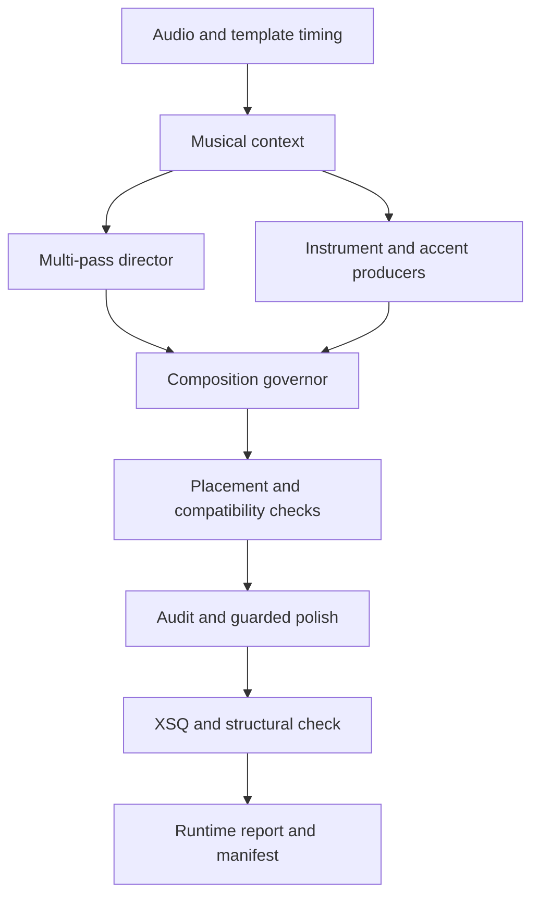

# Unified orchestration

## Execution paths at baseline

Base commit `3683449`. The CLI and Android call `sequence_builder.run_profile`. The desktop launcher also runs the CLI. The builder creates a run manifest and invokes the effects bridge before the audio has been analyzed. The bridge creates five synthetic sections, sends the intent graph through the multi-pass director and placement planner, and writes a sidecar XSQ when a template is available. Only explicit template promotion feeds it to the renderer.

The main sequence takes a separate path through `effect_engine_beat_grid.main_for` and `effect_engine.run_variant`. The variant loads a copy of the template and layout, analyzes audio, chooses compatible template timing tracks or detected beats and onsets, builds song parts, extracts stems, notes and optional lyrics, and runs the existing feature-specific passes. These passes call `add_model` to select effects and palettes, snap and retry timing, and serialize accepted placements. The timeline validator and audit/polish passes run before XSQ export. Explicit beat-grid postprocessing can modify the exported timing. Native xLights import/render is a separate verification step.

The director and the exporter use seconds and milliseconds, respectively. A separate beat-grid postprocess can move an effect again. Within the exporter the overlay and flash budgets were charged before cooldown, snapping, and placement checks. Unplaceable proposals could exhaust the budget and the eventual window could differ from the one charged. The timeline also removed a lower-priority effect before checking whether the incoming effect passed prop rules. Several analysis outputs are exported for inspection and have no direct effect on live placement.

## Engine responsibilities and maturity

| Existing subsystem | Live input and output | Baseline participation and interaction |
| --- | --- | --- |
| `xlights.xsq_writer`, `core.audio_intelligence` | Audio to envelopes, timing, optional stems and lyric events | Active analysis. Legacy base and stem loaders have separate decoding paths. |
| `rhythm_intelligence`, beat-grid modules | Selected beats/onsets to rhythm diagnostics and optional quantization | Rhythm insights are report-only. Live snapping and final explicit beat-grid postprocessing are separate. |
| `spatial_scene`, `spatial_mapping_engine`, `spatial_choreography_engine` | Layout geometry and spatial motion vocabulary | Scene and spatial chase are live. The standalone mapper is a separate path. Graph spatial choreography runs in the director. |
| `style_engine`, `style_engine_v2_adapter` | Style and intent decisions | Profile, runtime style and palette logic are live. The V2 adapter has its own test path. |
| `adaptive_emotional_storytelling_engine`, `show_identity_engine`, `visual_cinematography_engine`, `live_audience_energy_engine` | Intent graph to section, motif, motion and focal adjustments | Director passes on the seeded sidecar. Audience energy is a heuristic, independent of live audience input. |
| `matrix_intelligence` | Layout and musical marks to matrix plans/cues | Flagged live path with layout gating. |
| `effects.piano_effect` and polyphonic/keyboard functions in `effect_engine` | Harmonic analysis to notes, specialist plan, and keyboard or yard placements | Live placement and diagnostic plan are separate consumers. Piano role preference preserves no-piano fallback. |
| `core.drummer_v3_analysis`, `snowman_band`, `band_sync` | Drum streams and music timeline to performer cues and band planning | Band plan is live diagnostic/export input. Specialized drummer integrations also have dedicated scripts and render workflows. |
| `lyric_interpreter`, `lyric_phoneme_mapper`, vocal and band-face modules | Optional timed words, peaks and phonemes to lyric and face effects | Live routing is conditional. Native face export also has a separate path. |
| `birdsong_engine`, `birdsong_issue2_runtime` | Spectral and note data to accent phrases; optional runtime manifest | Live feature-gated accent path and separate optional hook. |
| `chronoflow`, `helixualizer` | Analysis and layout to trajectory, timing, visualizer exports and piano-neighbor hints | Active via Chronoflow; stereo and piano-roll analysis may decode or analyze independently. |
| `hardkor_engine` | Profile-specific rhythmic groups to effects | Active when its mode is selected. Preserve its effect vocabulary. |
| `effect_layering_engine`, `EffectTimeline` | Candidates to compatible layers | Standalone planner has tests. Live placement uses EffectTimeline and prop rules. |
| `self_improving_scoring`, `sequence_memory_engine` | Runtime report or intent graph to scoring and motif memory | Live scoring and optional persistence are separate from in-run graph motif memory. |
| `autonomous_masterpiece_evaluator`, `autonomous_render_validation_engine`, `choreography_correction_loop` | Graph to scores, readability findings and deterministic edits | Masterpiece and correction run in the director. Readability simulation evaluates intents and cannot validate native renders. |

## Baseline verification

The focused baseline suite for orchestration balance, bridge and promotion, correction, intent graph, palettes, and band sync passed 34 tests. The clean-room beta fixture produced an eight-effect XSQ and a runtime quality score of 81.0 using the default Master profile and its three-model layout. The real-audio baseline uses the repository's existing workflow fixture `Helix Audiolights.mp3` and checked-in Helixville4 layout for local rendering and comparison. The repository's native renderer was unavailable in this environment.

## Live path on the feature branch



The shared context carries the selected audio/template beats and bars, subdivisions and local tempo samples, onsets and instrument peaks, section energy and dynamics, detected polyphony, optional word and phoneme events, and quiet windows. It uses integer milliseconds for placement. The director reads section spans in seconds, then returns restraint to the governor by section start on the original clock. Chronoflow, Band Sync and Snowman Band consume the same selected timing and note or vocal inputs. Specialist extraction stays with its existing producer.

| Responsibility | Interaction policy |
| --- | --- |
| Director passes | Emotional storytelling, visual cinematography, spatial choreography, show identity and in-run sequence memory share one graph. Their live output governs low-density passages. The existing style, role routing and serializer continue to select concrete effects, colors and motion. |
| Owned specialist effects | Dedicated piano, singer and percussion tracks have higher same-layer priority than general choreography and accents when routed to their roles. General yard keyboard and lyric routing remain available on layouts without dedicated models. |
| Primary choreography | Profile rhythm, phrases, spatial motion and transitions keep their established priorities within their lane. The existing prop rules and concurrent-layer cap adjudicate compatibility. |
| Supporting accents | Pixel, multiband, spatial, audio-reactive and Birdsong cues share limited capacity. When a scheduled catalog cue is present in an eligible window, one slot is held through the audio-reactive pass. Measured quiet windows have a reduced budget. |
| Physical drummer hits | `--orchestrate-band-performers` routes detected events through Snowman Band to compatible kit components. Starts stay on the scheduled detector time. Hardkor retains its established mode and effect palette. |
| Evaluation and correction | The intent readability simulator can trigger one correction. The original plan survives if the proposed correction fails to remove a concrete issue or introduces another. Live placement, guarded polish and serialized XSQ validation run separately. Self-improving scoring keeps its existing data-use and persistence switches. |

The variant's existing `*.report.json` contains `orchestration`, including context counts, graph passes, proposal counts and reasons, direct model roles, budget utilization before and after polish, timing deltas, quality score, elapsed time, and XSQ verification. The existing desktop and Android log paths display the engine's summary. The run manifest identifies the sequence and report. The seeded sidecar and explicit template-promotion interfaces remain available. Use `--no-unified-orchestration` for the previous live placement and audit policy. Use `--no-effects-orchestrator` to skip the seeded sidecar.

## Release gates

Real performer playback still needs native import and rendering against the documented drummer oracle. Singer articulation still needs a permissioned annotated vocal fixture and native Faces playback. Model ownership uses named physical roles, so nested group membership and custom aliases need broader layout coverage. Existing specialized workflows for V2 style, venue intelligence and separate animation exporters remain separate. The seeded planning sidecar is still independent. This change shares the results of live analysis across consumers. It leaves separate optional stem, stereo and detailed piano-roll analysis with their specialized owners.

Native xLights installation and REST automation were unavailable. The read-only probe returned connection refused on both local xLights ports. Native FSEQ, Windows packaging, Android device playback, and controller/channel output are unverified. An explicit BeatGrid run can modify timings after the variant's XSQ checks. This is a separate timing override and requires its own final check.

## Verification on the feature branch

The real-audio comparison used the repository's workflow-approved `Helix Audiolights.mp3`, the checked-in Helixville4 layout with 499 recognized names, the same template, and a single Master variant. Workspace history and persistent scoring memory were disabled. The full track covers 237.44 seconds and 17 detected sections. The drummer comparison uses the first 36 seconds converted to PCM without changing the source. Helix MP4 previews accompany the matching XSQ artifacts. The excerpt comparison video is cut to the audio span because legacy template rows can extend the preview HUD beyond the excerpt.

| Fixture and metric | Base `3683449` | Unified default | Unified with drummer |
| --- | ---: | ---: | ---: |
| Full track, generated effects | 8,689 | 8,715 | — |
| Full track, runtime quality / 100 | 96.2 | 95.9 | — |
| Full track, show heuristic / 100 | 72.7 | 73.7 | — |
| Full track, prop role consistency / 100 | 86.5 | 87.6 | — |
| Full track, focal clarity / 100 | 57.1 | 58.7 | — |
| Full track, motion coherence / 100 | 90.7 | 90.7 | — |
| Full track, referenced palette rows | 36 | 36 | — |
| Excerpt, generated effects | 986 | 969 | 1,138 |
| Excerpt, runtime quality / 100 | 92.9 | 92.1 | 94.0 |
| Excerpt, exact drum target and detector-onset matches | 0 | 0 | 169 |
| Three-name clean-room fixture, generated effects | 8 | 15 | — |
| Three-name clean-room fixture, runtime quality / 100 | 81.0 | 87.1 | — |

The full-song and excerpt governed XSQs passed the generated-layer effect and palette checks, with zero final overlay or flash budget overages. The full track and excerpt each retained nine catalog audio-reactive placements. Two repeated clean-room runs emitted byte-identical XSQs (SHA-256 `f38cfee0751aab3f5e0d6d9e5f4c79eb28d4d3d7ca285d2cab9927cf08646e69`). The legacy opt-out retained eight effects and its 81.0 runtime score. The minimal fixture uses a synthetic root. The automated CLI test relabels a temporary copy as `xsequence` to verify serialized structure.

The full track gained focal and role scores while the general runtime grade fell 0.3 points. On the excerpt, kit routing gained 169 exact detector matches. This measures synchronization to the scheduler and layout, with no annotated audio ground truth for hit classification. The renderer shows model activation and does not provide native Faces playback or FSEQ fidelity. The small fixture also exposes denser valid layering, with a higher clutter penalty from 14 to 28. These tradeoffs leave the opt-in kit playback and broader artistic review open.

The full sparse-checkout suite produced **926 passed, 25 failed, 5 skipped, 1 xfailed and 1 collection error**. The same baseline run produced **915 passed, 26 failed, 5 skipped, 1 xfailed and 1 collection error**. The failing test and collection identifiers are unchanged except for the repaired Snowman Band test. Failures include unavailable assets in this checkout and existing drummer, layout, preview mux, and XSQ validation cases.

To reproduce at either revision, run the same fixture and profile against a fresh output directory. Add `--orchestrate-band-performers` for the separate kit case.

```bash
python main.py -- --template template.xsq --layout-file helixville4/xlights_rgbeffects.xml \
  --audio "Helix Audiolights.mp3" --output-dir /tmp/helix-orchestration-review \
  --variants 1 --single --no-prompt --no-save-settings --no-workspace-history --no-learning-memory
```
