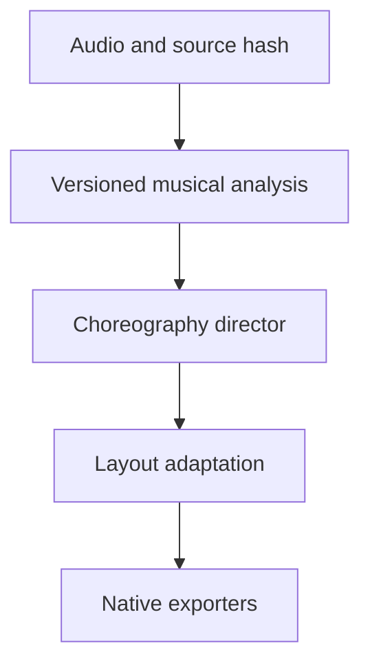
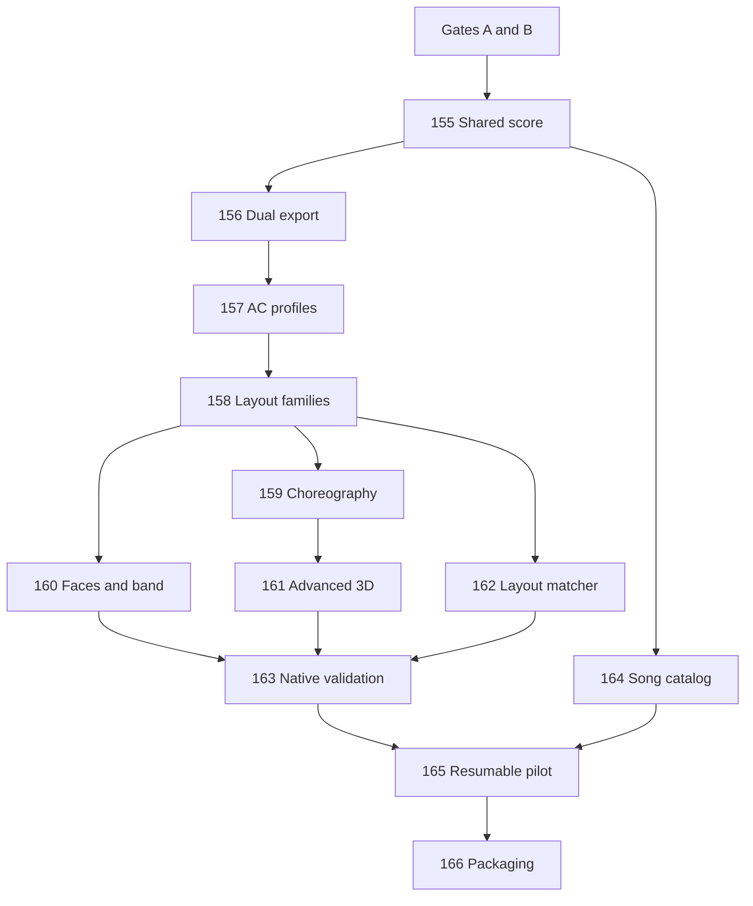

# Universal Sequence Library — approval-gated implementation plan

Parent specification: [Issue #154](https://github.com/ryankorkowski-boop/helix-sequencer/issues/154). Stage A is planning only. Stage B has **not** been authorized. Current musical optimization and video production remain the immediate priority.

## Baseline and audit

Audit date: 2026-10-16 UTC. Default branch `feature/restructure-core` HEAD was `1f66f5dfa09b3173f5cdfd33d28ab1b4421e11ad`. The latest development stack is PR #153 at `f8fafec4c3ad4e1495306613cc29dd0fd00e7d44`, based on #152 → #151 → #150 → #148 → #147 → #146. #149 is already consolidated in #150; do not integrate it twice. These PRs remain open and user video approval is outstanding.

The latest source has successful general, native output and Windows CI, but Android run 38840820654 failed in the API30 emulator step; API36 passed. Root cause is not established by the job summary. Historical success receipts do not make the newest stack universally green. Physical CTB16PC/controller and licensed vendor LOR testing remain unverified.

PR #151 records a prior 40-video delivery. #152/#153 changed the cast to seven snowmen with separate keyboard/mallet players. The present request supersedes that choice for new showcases: **six snowmen, one unified pitched-instrument performer, holiday and rock-costumed snowman variants**. Historical scenes and contracts must stay available. Existing review counts do not count as new production.

| Capability | Current implementation | Remaining work |
|---|---|---|
| Musical event representations | `music/note_events.py`, `audio/musical_events.py`, `core/plan/sequence_plan.py` | Version shared score; include provenance, capabilities, confidence and semantic cues without parallel detector stacks. |
| Native xLights | `core/final_band_export.py`, `core/band_xlights_export.py`, `core/keyboard_rung_export.py`, native show tools | Consolidate adapters from shared score; retain application-version parity evidence and relative assets. |
| LMS/AC | `tools/legacy_lms_export.py`, `tools/lor_lms_export_from_source.py`, `core/ctb16pc_sequence.py`, `core/output_capabilities.py` | Existing paths are selective/opt-in. Both formats by default across all entrypoints is not implemented. LOR app/hardware acceptance remains blocked. |
| Vocal roles and models | `music/vocal_roles.py`, `models/native_review_band.py`, `core/band_vocal_face_export.py` | Preserve evidence-aware abstention and distinct circuits; align six-member current direction across render/native adapters. |
| 3D/spatial | `models/review_spatial_worlds.py`, `models/showcase_flavors.py`, `music/review_score.py` | Capability-aware adaptation and matcher; migrate archived intermediate Style Engine XML before a universal native claim. |
| Lyric interpretation | `core/lyric_interpreter.py`, `config/lyric_trigger_lexicon.json` | Existing interpreter reports mood/triggers; audit found no direct final-output consumer for `trigger_hits`/overall mood. Exact color/brightness/shimmer/flicker behavior needs an explicit tested adapter. Showcase correction may proceed separately; library architecture stays planning-only. |
| Activity selection and caching | `tools/showcase_excerpt_rank.py`, `tools/showcase_source_analysis.py` | Existing source-bound caches reusable; inventory every recording, never infer duplicates from names. Spectral proxies are not confirmed instruments. |
| Packaging/validation | `tools/package_showcase_review.py`, `tools/verify_showcase_review.py`, workflows | Generalize only after approval; separate XML structure/native import/render/hardware outcomes. |

## Architecture

One authoritative score carries source hash, sample/time base, analysis version, estimated/verified instrument events, phrase/beat timing, words/phones with evidence, intentional darkness, palette/brightness/effect envelopes, trajectories, role groups and immutable IDs. Layout adaptation produces target-specific choreography and explicit capability/fallback records. Native XSQ and LMS adapters consume this score, preserving timestamps and identities; they must not independently redetect music. Continuous RGB spatial effects need deliberate AC alternatives, not silent deletion.

Each generation invocation eventually attempts both exporters independently. The result manifest records `requested`, `success`, `partial`, `failed` or `unsupported` per format, target application/version range, produced files/checksums, warnings, failure codes and actionable fixes. A partial or unsupported result cannot masquerade as a fully compatible sequence. Preserve useful output when the other exporter fails.

## Implementation issues and dependencies

| [#155](https://github.com/ryankorkowski-boop/helix-sequencer/issues/155) | Shared musical analysis and versioned choreography data | Gates A/B | BLOCKED |
| [#156](https://github.com/ryankorkowski-boop/helix-sequencer/issues/156) | Universal dual-format XSQ and LMS orchestration | #155 | BLOCKED |
| [#157](https://github.com/ryankorkowski-boop/helix-sequencer/issues/157) | CTB16PC and expanded AC controller profiles | #155, #156 | BLOCKED |
| [#158](https://github.com/ryankorkowski-boop/helix-sequencer/issues/158) | Residential layout families and capability-aware adaptations | #155, #157 | BLOCKED |
| [#159](https://github.com/ryankorkowski-boop/helix-sequencer/issues/159) | Professional choreography templates and lyric semantics | #155, #158 | BLOCKED |
| [#160](https://github.com/ryankorkowski-boop/helix-sequencer/issues/160) | Singing faces and six-snowman band sequence profiles | #155, #157, #158 | BLOCKED |
| [#161](https://github.com/ryankorkowski-boop/helix-sequencer/issues/161) | Advanced 3D worlds and musical spatial adaptation | #155, #158, #159 | BLOCKED |
| [#162](https://github.com/ryankorkowski-boop/helix-sequencer/issues/162) | Automatic layout matching and reviewable remapping | #155, #157, #158 | BLOCKED |
| [#163](https://github.com/ryankorkowski-boop/helix-sequencer/issues/163) | Native import/export validation and compatibility matrix | #156, #157, #160, #161, #162 | BLOCKED |
| [#164](https://github.com/ryankorkowski-boop/helix-sequencer/issues/164) | Eligible free music catalog and metadata lineage | #155 | BLOCKED |
| [#165](https://github.com/ryankorkowski-boop/helix-sequencer/issues/165) | Resumable cached pilot and batch-generation pipeline | #156, #158, #159, #160, #161, #162, #163, #164 | BLOCKED |
| [#166](https://github.com/ryankorkowski-boop/helix-sequencer/issues/166) | Review download packaging, previews and import instructions | #163, #164, #165 | BLOCKED |

Issue bodies contain full prerequisite lists; this graph highlights the execution sequence. All issues remain blocked even where code already exists. No roadmap checkbox authorizes implementation.

## Profiles and choreography

| Profile | Intended target | Acceptance distinction |
|---|---|---|
| AC16 | One CTB16PC | At most 16 circuits, mapped intensity/fades and meaningful restraint. |
| AC32–64 | Two to four AC banks | Unique bank/unit/circuit addressing and role separation. |
| Residential Basic | Small pixel homeowner display | Sparse props choreographed intentionally. |
| Residential Standard | Common xLights houses | Roof/window/arch/trees/groups and reviewable mapping. |
| Mega Tree | Tree-centered display | Phrase and pitch motion designed for tree geometry. |
| Singing Band | Faces/instruments | Six snowmen with unified pitched performer; independent vocals require evidence. |
| Advanced 3D | Layered spatial display | Native transforms, depth, camera and model/submodel parity. |
| Ultimate Helix | Multi-house dual stages | Musical 88-rung helixes, spiral groves, spatial density and separation. |

Variants share analysis and soundtrack timing but each has its own choreography, density and channel budget. Professional references are authorized examples/public demos only. Do not copy vendor arrangements/assets. Evaluate precise timing, phrase structure, palette choices, independent activity, density, movement, transitions, darkness and finales; avoid undifferentiated whole-display pulsing.

## Matcher and catalog

Matcher inventory includes models/submodels/groups, prop types, pixel/channel counts, controllers, geometry, faces, mega trees, arches and custom props. Rank compatibility deterministically and show missing/incompatible props, effect loss, channel conflicts and suggested remaps before user acceptance. Fewer props require a musical adaptation, not hidden omissions.

Catalog IDs are based on original bytes and decoded audio identity, with durations, fingerprints, arrangement lineage and rights evidence. Equal filenames or sizes do not prove duplicate recordings. Retain HelixXMix/hardKor metadata where applicable; never alter source originals. Browsing filters cover song/style/Christmas, profile, controller, channels, pixels, required props, complexity, native software/version support and limitations. Audio distribution eligibility remains separate from permission to make these user-requested review videos.

## Batch plan

After Gate B, start with three approved songs and at least three layout families including AC16. Stages: inventory → cached analysis → shared choreography → per-profile adaptation → two independent exports → structural/native validation → representative fresh MP4 → package → index. Cache keys include audio hash, analysis/score/schema version, profile definition, exporter/native app version and renderer revision. Write artifacts atomically; store stage status and hashes. Resume only if every input/output hash agrees; invalidate descendants after changes. Isolate one-song/format failures, preserve logs and report an incomplete job truthfully.

Packages contain Song / Layout Variant / xLights and LOR / Models / Instructions / Preview, compatibility manifests, required assets, source references and checksums. No mass publishing, sharing changes or release uploads in Stage A.

## Objective acceptance

- Shared score determinism, schema roundtrip, exact timebase and stale-cache rejection.
- Both exporter attempts even when the first fails; explicit failures and supported fallbacks.
- Actual xLights import/render with version and channel parity; standalone model/assets and 3D groups valid.
- Actual supported LOR application import/playback when available; XML or self-roundtrip alone is structural evidence.
- CTB16PC <=16 circuit banks, unique addresses, low intensity, retrigger gaps, fade/intensity roundtrip.
- Model remapping/fewer props/missing assets/unsupported effects/collision cases.
- Vocal phoneme channel distinctness, evidence-backed voice roles, no invented choir identities.
- Drum/string/pitched contact timing and motion limits; annotated fixtures for accuracy claims.
- Native geometry, 88 independent MIDI rungs and 2D/front-3D projection checks.
- Video full decode, exact frames/duration, source soundtrack correspondence, measured alignment, black/freeze checks and diagnostic images.
- Desktop and Android entrypoint exports plus large/interrupted/resumed batch cases.
- CRC/checksum/package completeness, honest compatibility documentation and user artistic review.
- Hardware checks are only marked complete after actual devices are used.

## Gates

A: Current active development complete or explicitly resolved; latest baseline checks and reviews recorded.
B: Explicit user approval of current output **and separate authorization to start #154**, with exact evidence and baseline SHA.
C: Three-song pilot with real XSQ/LMS/layout/MP4 outputs and application-validation evidence.
D: Explicit user pilot approval before mass generation.
E: Approved catalog-wide generation; **public publication remains a separate explicit approval**.

Current release approval, passing CI, silence or previous renders unlock none of the later gates. No production sequencing behavior is changed by this planning document.

